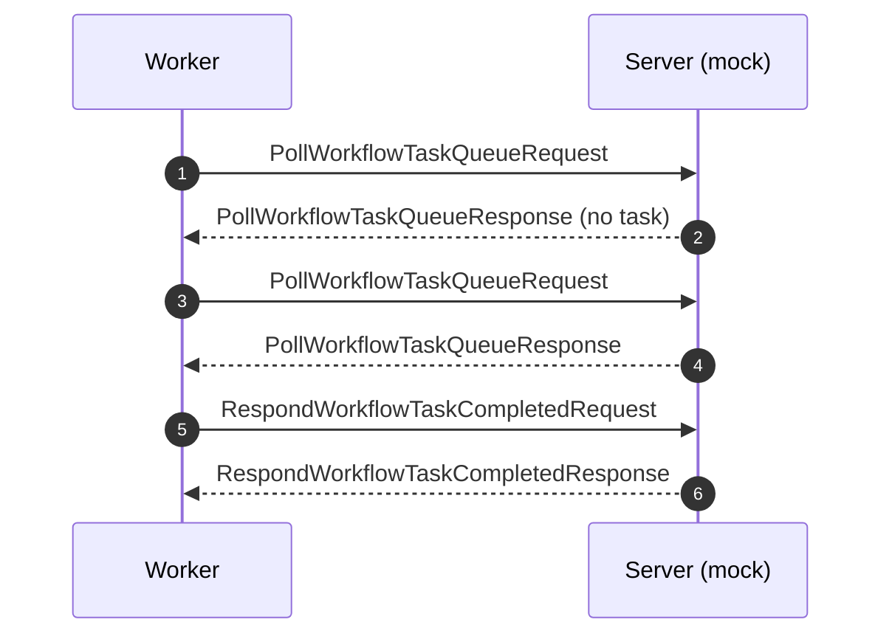
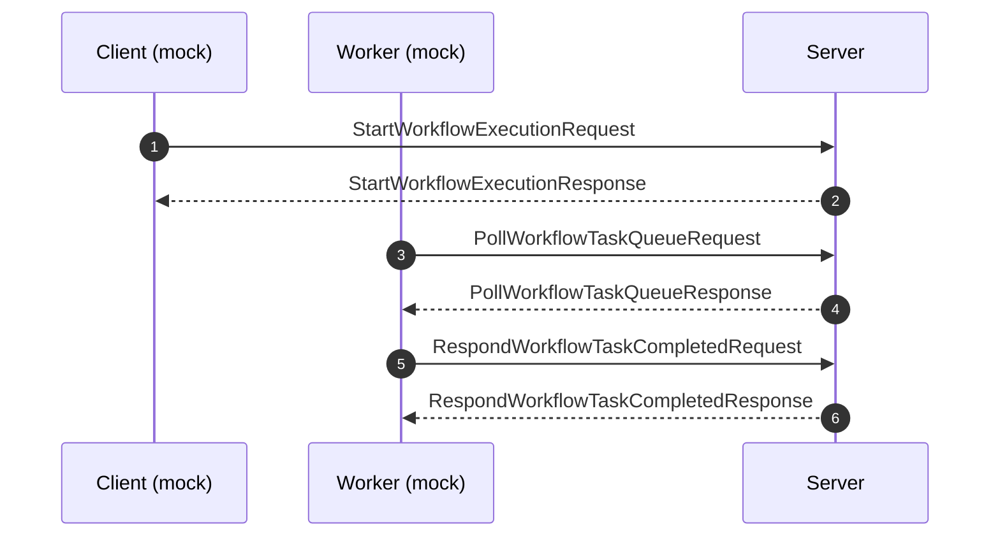
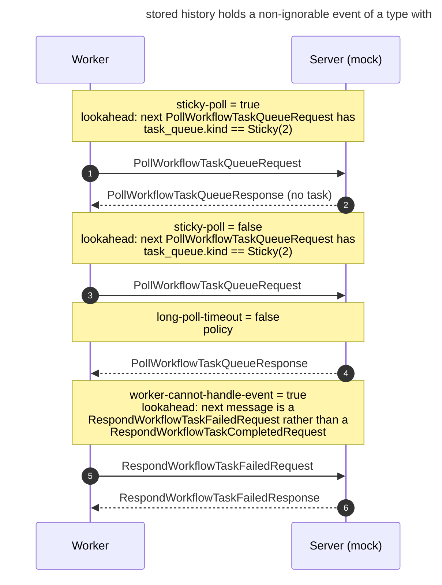

# Mermaid sequence diagrams from `rpcspec` specifications

Working notes for an agent continuing this work. Updated at the end of each step.

## What we are trying to achieve

`rpcspec` specifications are executable Go programs describing the SDK/Server RPC
conversation. We want to execute them so that they **emit mermaid sequence
diagrams**, in two increasingly ambitious senses:

1. A diagram of **one run** — what actually crossed the wire, against a real peer.
2. A diagram of **the specification itself** — every conversation the spec permits,
   with the branches drawn as mermaid `alt`/`else` blocks. This requires exploring
   the spec's choice space rather than observing a single path through it.

The second is the real prize. It turns a specification into documentation of the
contract, not just a test oracle.

## Why this is possible at all

Three properties of the existing code, all verified:

- **The transcript is already a sequence diagram.** `Send` is the only thing that
  appends to `core.transcript` (`spec/session.go:208`). Nested `Satisfy` calls for
  History Events and Commands do not appear, so the transcript holds wire messages
  and nothing else.
- **A run is deterministic given its choice sequence.** `Maybe` is the only
  consumer of nondeterminism in synthesizer mode (`spec/session.go:246`), and the
  constraint solver's `genctx` is a plain monotonic counter, documented as "the
  deterministic state a solver needs to invent values" (`spec/constraint.go:33`).
  No `rand`, no clock. So replaying a prefix of choices reproduces a run exactly.
- **Synth mode needs no peer.** The whole `Transport` surface is five call sites.
  In all-`Synth` mode only `Mode` and `Emit` are reachable; `Recv` and `Peek` are
  not. A null transport is therefore ~20 lines and provably sufficient.

## The 4-step plan

| Step | What | State |
| --- | --- | --- |
| 1 | Level 1 renderer, factored | **done** |
| 2 | Level 2a: record `Maybe` decisions | **done** |
| 3 | Level 3: null transport + choice-prefix explorer + tree renderer | todo |
| 4 | Loop detection via call-site capture (optional polish) | todo |

Pause for user feedback after each step.

## Verifying a diagram actually renders

Do not trust that emitted mermaid parses. It is worth the round trip:

```bash
npx -y @mermaid-js/mermaid-cli@11 -i diagram.mmd -o out.png -s 2
```

This caught two real defects in Step 2 that reading the text did not: notes running
off both edges of the drawing, and a clipped title.

---

## Step 1 — done

### What was built

**`spec/mermaid.go`** — renders a `*Result` as a mermaid sequence diagram.

- `MermaidOptions{Title, Autonumber, Detail, Caller}.Render(*Result) string`, and
  `(*Result).Mermaid()` as the zero-configuration form.
- `endpointsOf(Role) (from, to Party)` and `renderEntry(Entry) string` are the
  per-message half. **Step 3 reuses these unchanged** — that is why they take an
  `Entry` and return a line rather than writing into a run-shaped buffer.
- `participants([]Entry) []lifeline` computes the lifelines and labels a party
  `(mock)` when every message it produced was `Synth`. This is the thing a diagram
  knows that an ordinary trace does not: which side the runner was playing.
- `mermaidText` escapes `#`, `;` and newlines, which would otherwise break a label.

**`test/diagram.go`** — `emitDiagram(t, res)` logs the diagram and, when
`RPCSPEC_DIAGRAM_DIR` is set, writes one `.mmd` per run. `pollDetail` annotates an
empty long poll as `(no task)`, since it is the same message type as a delivered
task. Wired into `runSpec` in `test/mockserver_test.go` and into
`test/mockworker_test.go`.

**`spec/mermaid_test.go`** — 7 tests, no peer required.

### One design decision worth not relitigating

`Direction` only distinguishes SDK from Server, so a `StartWorkflowExecution`
response would be drawn to the Worker instead of the Client. The fix is
`clientMethods`, a hand-maintained table in `spec/mermaid.go`.

**This cannot be derived from the descriptor, and one plausible route was tried and
rejected.** Worker methods carry no `google.api.http` option — the proto says so
outright, "We do not expose worker API to HTTP" — but neither do deprecated and
internal methods (`DeprecateNamespace`, `ScanWorkflowExecutions`,
`ListOpenWorkflowExecutions`). Absence of the annotation means "not reachable over
HTTP", not "called by a Worker". Verified against the compiled descriptor. The
table is deliberately confined to unambiguously client-driven methods; anything
absent defaults to `Worker`, and `MermaidOptions.Caller` overrides it.

### How to produce a diagram today

Against a real Go SDK Worker (mock Server side):

```bash
cd rpcspec && RPCSPEC_DIAGRAM_DIR=/tmp/diagrams go test ./test/ -run TestMockServerAgainstRealGoSDK
```

Against a real Temporal Server (mock Worker side; needs the `temporal` CLI):

```bash
cd rpcspec && RPCSPEC_DIAGRAM_DIR=/tmp/diagrams go test ./test/ -run TestMockWorkerAgainstRealServer
```

Without the env var the diagrams still appear in the test log under `go test -v`.
Paste a `.mmd` file into any mermaid renderer.

### Verified output

Both directions run green, and they are exact inverses of one another — the same
specification, with the `(mock)` label on the opposite side. Mock Server against a
real Worker:



Mock Worker against a real Temporal dev Server:



### Known limitation carried forward

A request and its response are not paired into a mermaid activation box, because
several interchangeable long polls may be outstanding at once and correlation is
the transport's job, not the specification's. Left flat deliberately.

---

## Step 2 — done

### What was built

**`spec/diag.go`** — the `Choice` type, recording `AfterSeq` (how many messages had
crossed the wire when the decision was made), `Label`, `Taken`, `FromLookahead`,
and `Describe`.

`Describe` is captured **in both arms**, including the policy arm where the `Peek`
is never evaluated. What the lookahead *would* have asked is the best available
name for the branch, and Step 3 has nothing else to title an `alt` block with.

**`Result.Steps() []Step`** — interleaves messages and choices back into the order
they happened. Choices are stored apart from the transcript so `Entry` stays "one
message" and the transcript stays a record of the wire; `Steps` is the single place
the two orders are reconciled, used by `Result.String()`, `Violation.Error()` and
the renderer alike. **Step 3's tree merge should use this too.**

Ordering rule: a choice precedes the entry with `Seq == AfterSeq+1`; several
choices sharing an `AfterSeq` keep their slice order.

**`spec/session.go`** — `core.choices`, `core.record(...)`, and `Result.Choices` /
`Violation.Choices` populated on all three exit paths in `Run`.

**`spec/mermaid.go`** — `renderChoice` draws each decision as a `Note over`
spanning the lifelines, plus `HideChoices` to suppress them. `wrapNote` /
`wrapWords` break note text at `noteWidth` (52) on spaces only.

**Diagnostics improved as a side effect.** `Violation.Error()` now lists branches
alongside messages in "conversation so far" — which way the conversation went is
usually *why* the message that failed was the one expected. No test asserted on
that format, so this was safe.

### Two wording/layout decisions, both driven by looking at rendered output

- **A note names the question, not the answer.** First draft rendered
  `sticky-poll = false — next PollWorkflowTaskQueueRequest has task_queue.kind ==
  Sticky(2)`, which reads as though the description held — wrong on the arm where
  the branch was *not* taken. Now it is `label = value` on one line and
  `lookahead: <describe>` (or `policy`) on the next. Keep this property in Step 3.
- **Notes must be wrapped.** A mermaid note is drawn as wide as its longest line,
  and the lookahead descriptions exceed 120 characters, so unwrapped notes pushed
  off both edges of the drawing. Only visible by actually rendering.

`test/diagram.go` also shortens titles (`diagramTitle`) because mermaid clips a
title wider than the drawing instead of wrapping it.

### Verified output

All emitted diagrams were rendered through `@mermaid-js/mermaid-cli@11` and
inspected. A live mock-Server run against a real Go SDK Worker, on the
non-ignorable-unknown-event case:



### The observation worth carrying into Step 3

The same branch flips its source between the two directions. In the mock-Server
run, `sticky-poll` is a **lookahead** (the Worker's request decides) and
`long-poll-timeout` is a **policy** choice. In the mock-Worker run against a real
Server it is exactly inverted. That is the "one specification, two modes" claim
made visible.

It also states Step 3's premise precisely: **under the null transport every branch
is a policy choice**, because both directions are `Synth`. There is nothing to read
off the wire, so the explorer controls every decision — which is what makes
exhaustive enumeration possible at all.

---

## Step 3 — todo: the choice-prefix explorer

**Goal.** Draw the specification, not one run: every path it permits, as nested
`alt`/`else`.

### The explorer

A run is a deterministic function of the booleans `Policy` returns. Drive `Policy`
from a vector plus a cursor:

```go
type prefix struct {
    choices []bool
    n       int
    log     []choice // {index, seq, label, describe, value}
}

func (p *prefix) Decide(label string) bool {
    v := p.n < len(p.choices) && p.choices[p.n] // default false past the prefix
    p.log = append(p.log, choice{index: p.n, label: label, value: v})
    p.n++
    return v
}
```

DFS by flipping the last unexplored choice:

1. Run with prefix `[]`; it consumes *k* choices, all defaulting `false`.
2. For each `i` in `k-1 … 0` where `choices[i]` was `false`, push
   `choices[0:i] ++ [true]`.
3. Pop, re-execute **from the top** with a fresh config, replay, default `false`
   beyond. Repeat.

No continuations, no snapshots — just deterministic re-execution.

### Four concrete requirements

- **`Run` needs a config factory, not a config.** The signature is
  `Run[C](cfg *C, ...)` and specs mutate `s.C` heavily (`Phase`, `History`,
  `Attempt`, `EventSupport`). The explorer must call something like
  `polling.New(...)` per run. That factory already exists in the right shape.
- **Index choices positionally, never by label.** Labels repeat across loop
  iterations (`long-poll-timeout` fires once per poll).
- **Bounds are mandatory.** `Polling` loops until `Phase == "closed"`, and
  `long-poll-timeout` returning `true` forever diverges. Cap choices-per-run,
  transcript length, and total runs — and mark truncated paths **in the diagram**.
  "We stopped looking here" is a claim about the drawing, not a detail to hide.
- **The null transport is a mode combination no live run has.** Real transports are
  `Check` one way and `Synth` the other; this one is `Synth` both ways. Correct for
  documenting the contract, but say so — and note that `participants()` will label
  every lifeline `(mock)`, which is accurate but worth a different presentation for
  a spec-level diagram (probably drop the `(mock)` suffix entirely there).

### Merging and rendering

Prefix sharing is guaranteed **by construction**: two runs agreeing on
`choices[0..i]` produce byte-identical transcript prefixes up to where choice `i+1`
is consumed. So merging is a mechanical zip, not a diff heuristic — and Step 2
already provides the merged per-run stream to zip over, via `Result.Steps()`. Build
a tree whose nodes are messages and whose branch points are choices; walk it
recursively emitting:

```
alt <describe() of the choice>
    ...true subtree...
else <negation>
    ...false subtree...
end
```

Reuse `endpointsOf`, `renderEntry`, `wrapNote` and `mermaidText` from
`spec/mermaid.go` verbatim. Only the driver differs — Step 1 folds a list, Step 3
walks a tree with indentation. Note that `renderEntry` hard-codes a four-space
indent; a tree renderer needs that parameterized, which is the one small change
Step 1's code will need.

`alt` titles should use `Choice.Describe`, falling back to `Label` when a Peek
returned an empty description. Keep the Step 2 property that a branch label names
the *question*, so the `else` arm is not mislabelled.

Suggested placement: `spec/explore.go` (null transport + explorer) and
`spec/mermaid_tree.go` (tree renderer), plus a `cmd/` entry point so a diagram of
the spec can be produced without a peer at all — which is the headline capability.

---

## Step 4 — todo: loop detection (optional polish)

Unrolled paths are honest but verbose. Capture which spec function emitted each
message — `callSite()` already walks to the first frame outside the `spec` package
(`spec/diag.go:89`) — and use repeated entry into the same function at the same
stack depth to emit a mermaid `loop` box instead of a raw unrolling.

Note the earlier analysis: the *renderer* half of "call-stack grouping" (drawing
`rect` boxes per spec function on a flat transcript) does **not** transfer to the
tree, where `rect` nesting competes with `alt` nesting for the same visual budget.
It is the *data capture* that is worth having, for loop detection. Do not build the
flat `rect` renderer as a separate deliverable.
